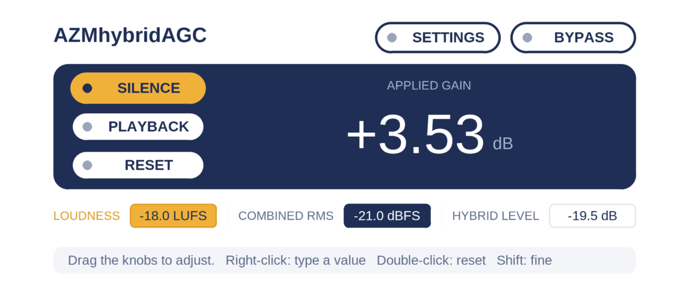
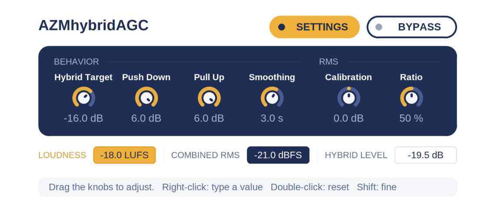

# AZMhybridAGC

目標音量へゆるやかにゲインを調整します。

## 特長

- ラウドネスと RMS を同時に計測し、設定された割合で混合を行った Hybrid Level を基準に音量調整を行います。
- 累積 Hybrid と直近 400 ms の Short Hybrid を混合し、急激な音量変化に対するゲインの追従性を高めます。
- 一定時間の無音・プレイバックによって自動で再計測されます。手動で測定をリセットすることもできます。
- ルックアヘッドによる遅延はありません。

## 注意事項

- **リミッターやピーク保護はありません。** ブーストによりピークが 0 dBFS を超えることがあるため、必要に応じて後段にリミッターを置いてください。
- REAPER のトラックルーチング上のステレオ入力を前提としています。
- 測定値は厳密な EBU R128 の Integrated Loudness とは完全には一致しません（[アルゴリズム](docs/algorithm.md)を参照）。
- 入力が極端で測定範囲を超えると、`MEASUREMENT ERROR - RESET` を表示してゲインを固定します。入力レベルを確認してから `RESET` してください。
- 音声がプラグインに届いていれば、停止中も動作します。ホストが停止中の処理を中断する場合は、その間は測定・補正できず、再生開始を検出できないこともあります。ループバックなどを使う場合は、ホスト側で入力モニタリングとルーチングを設定してください。

## 導入

JSFX に対応したホストのエフェクト用フォルダに [`jsfx/AZMhybridAGC.jsfx`](jsfx/AZMhybridAGC.jsfx) をコピーしてください。フォルダの場所や追加方法は使用するホストの案内を参照してください。

VST として使用する場合は [ysfx](https://www.realinks.net/links/ysfx/) を使用してください。

## 使い方

基本的には挿しっぱなしで大丈夫です。もし微調整を行いたい場合は以下に説明する内容に従って調整してください。

## 操作画面

画面中央に現在適用されているゲイン量が表示されます。

左側には計測リセットにかんする操作項目があります。項目は以下です。

| 項目 | 説明 | 既定値 |
| --- | --- | --- |
| SILENCE | Hybrid Gain で −60 dBFS 未満が 5 秒続くと計測をリセットします。 | On |
| PLAYBACK | 停止・一時停止から再生へ移るときにリセットします。Off にすると、停止中に蓄積した値を再生開始後も維持します。 | Off |
| RESET | 手動でリセットします。 | — |

グラフ下の数値は入力の **LOUDNESS**、Calibration 適用後の **COMBINED RMS**、両者を混合した **HYBRID LEVEL** です。測定がまだできていないときは `--`、測定エラー中は `MEASUREMENT ERROR - RESET` と表示されます。

また、`SETTINGS` ボタンを押すと挙動にかんする設定項目が表示されます。

調整可能な項目は以下です。

| 項目 | 説明 | 範囲 | 既定値 |
| --- | --- | --- | --- |
| Hybrid Target | 目標とする音量 | −36〜−6 dB | −16 dB |
| Push Down | 音量を減衰させる上限。大きいほど減衰方向のゲインが速く動く | 0〜6 dB | 6 dB |
| Pull Up | 音量を増加させる上限。大きいほど増加方向のゲインが速く動く | 0〜6 dB | 3 dB |
| Short Mix | 音量調整の基準に直近 400 ms の測定値を混ぜる割合。0% で累積した測定値のみ。100% で直近 400 ms の影響が最大（内部の混合割合 30%） | 0〜100% | 50% |
| Calibration | RMS 計測値のオフセット | −12〜+12 dB | 3 dB |
| Ratio | Hybrid Gain 算出時の重み付け割合。0% で Loudness のみ、100% で RMS のみ | 0〜100% | 30% |

Push Down と Pull Up は、それぞれ減衰・増加方向のゲイン変化速度を調整します。速度係数の最低値は設定値 0dB 時の 0.1 です。また、目標ゲインの平滑化時間は 0.4 秒固定ですが、減衰方向は平滑化せず即座に反映します。Short Mix の直近 400 ms の測定値は、累積値より大きいときは即座に、小さいときは時定数 2 秒で緩やかに反映します。

**BYPASS** ボタンを押すと処理を行いません。

## 備考

詳しい処理については [アルゴリズム](docs/algorithm.md) を参照してください。
