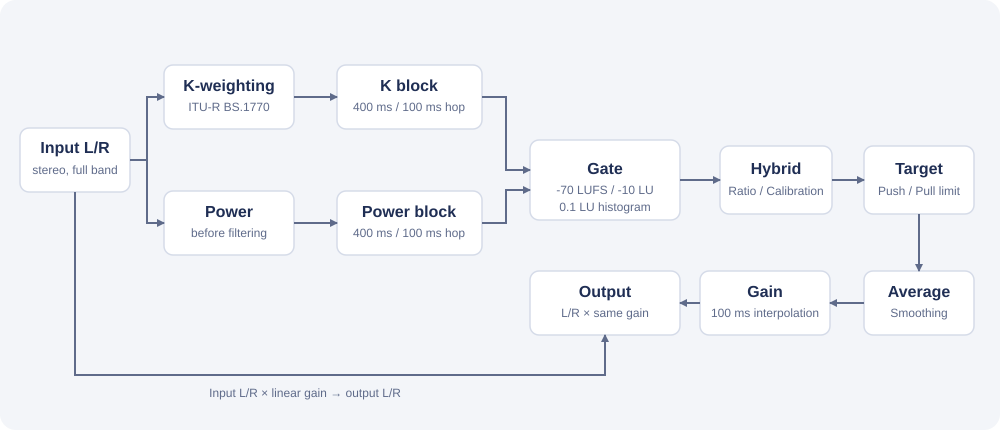

# アルゴリズム

[`jsfx/AZMhybridAGC.jsfx`](../jsfx/AZMhybridAGC.jsfx) の信号処理を説明します。画面と操作は [README](../README.md) を参照してください。



入力側のステレオ信号からラウドネスと RMS を測定・蓄積し、累積 Hybrid と直近 400 ms の Short Hybrid を `Short Mix` で混合したレベルが目標に一致するよう、左右に同一ゲインを適用します。測定は入力側で行うため、補正後の音量が測定値にフィードバックされることはありません。処理はフルバンドで、ルックアヘッドによる遅延はありません。リミッターやピーク保護はなく、ゲインは ±6 dB の範囲に制限されます。

## ブロック測定

各サンプルで、次の 2 つの電力を 100 ms ごとの区間（ホップ）に積算します。

- K 重み付け後の左右のパワーの和（ラウドネス用）。ハイシェルフとハイパスの 2 段の biquad で、係数はサンプルレートに合わせて計算します。
- フィルター前の左右平均パワー（RMS 用）。

4 ホップ（400 ms）を 1 ブロックとして、100 ms ごとに重複ブロックを作ります。最初の 400 ms 分のホップがそろうまでは測定を始めません。

```text
block_K = 4 ホップ分の K 重み付けパワーの平均
block_R = 4 ホップ分の左右平均パワーの平均
l = -0.691 + 10 * log10(block_K)
```

`l` が −70 LUFS 未満のブロックは捨てます。`l` が 60 以上、または入力が NaN・絶対値 1,000,000 超の場合は測定エラーとなり、リセットされるまでゲインを固定します。

## ゲートと累積

絶対ゲート（−70 LUFS）を通過した全ブロックを、`l` を 0.1 LU 刻みにしたヒストグラム（1300 ビン）へ集約します。各ビンはブロック数と、K 重み付けパワー・RMS 用パワーの合計を持ち、ブロックが増えてもメモリ使用量は一定です。

相対ゲートは、絶対ゲートを通過した全ブロックの平均から求めます。

```text
threshold = max(-70, -0.691 + 10 * log10(total_K / total_n) - 10)
```

ビンの中央値が `threshold` 以上のビンを選び、選んだビンの合計から Loudness と RMS を求めます。

```text
Loudness = -0.691 + 10 * log10(sum_K / n)
RMS      = 10 * log10(sum_R / n)
```

ブロックが追加されるたびに選択をやり直すため、過去のブロックも相対ゲートの変化に応じて再び選ばれます。相対ゲート境界ではビンの中央値で判定するため、厳密な EBU R128 Integrated Loudness とは完全には一致しません。RMS も同じ選択ブロックから求めます。

## 混合と目標ゲイン

`Ratio` を `m`（0〜1）として、dB 値を混合します。

```text
Hybrid = (1 - m) * Loudness + m * (RMS + Calibration)
```

これは、ゲートで選んだ累積した測定値から求めた値です。画面の `HYBRID LEVEL` もこの値です。

### 直近 400 ms（Short Mix）

ゲートを通さない直近 1 ブロック（400 ms）の K 重み付けパワーと左右平均パワーからも、同じ式で `Short Hybrid` を求めます。このブロックのラウドネスが −70 LUFS 未満のときは使わず、累積した値だけで調整します。`Short Mix` を `s`（0〜1）として、ゲインが追従するレベルを決めます。

```text
Short_Hybrid = (1 - m) * Short_Loudness + m * (Short_RMS + Calibration)
Level        = (1 - s) * Hybrid + s * Short_Hybrid
target_gain  = clamp(Hybrid_Target - Level, -Push_Down, +Pull_Up)
```

`s` が 0 なら累積した値だけ、1 なら直近 400 ms だけに追従します。相対ゲートで累積値から外れる静かな区間や、累積値に反映されるまで時間のかかる大きな音量変化にも、ゲインが追従します。

測定できるブロックがまだない間、目標ゲインは 0 dB です。

## 平滑化と出力

目標ゲインは 100 ms ごとに 4 個のリングバッファへ記録し、直近 0.4 秒の移動平均を求めます。この長さは固定です。実ゲインは、この平均値に向かって 100 ms かけて直線的に補間し、その速さに `Push Down` と `Pull Up` を反映します。

```text
smooth_goal = mean(target_gain の直近 4 個)
limit       = clamp((G + smooth_goal) / 2 >= 0 ? Pull_Up : Push_Down, 0, 6)
speed       = 0.1 + 0.9 * limit / 6
gain_step   = (smooth_goal - G) / (0.1 * fs) * speed   // 1 サンプルあたり
G = clamp(G + gain_step, -6, +6)
output_L = L * 10^(G / 20)
output_R = R * 10^(G / 20)
```

`speed` は 6 dB で 1、0 dB で 0.1 です。現在のゲインと `smooth_goal` の中間が 0 dB 以上のときは Pull Up、未満のときは Push Down を使います。値を小さくすると動きは遅くなりますが、0 にしても止まりはしないため、ゲインは 0 dB へ戻れます。

測定エラー中は目標を現在のゲインに固定し、ゲインは変化しません。

## リセット

次の場合に測定履歴（ヒストグラム、移動平均、現在の測定値）を消去し、400 ms のブロックから学習し直します。

- `RESET` の操作
- サンプルレートの変更
- 無音リセット（`SILENCE` が On のとき）
- 再生リセット（`PLAYBACK` が On のとき、停止・一時停止から再生へ移った時点）

## 無音の扱い

100 ms ごとに、左右平均パワーが 10⁻⁶（−60 dBFS）未満かどうかを判定します。無音と判定したホップが 5 秒続くと、無音リセットを 1 回だけ実行します。閾値と時間は固定です。

無音の間は、目標ゲインを現在のゲイン以下に制限し、ゲインが増加しないようにします。ゲインを下げる方向の補間は続きます。無音でないホップが来るとカウントを戻し、再び無音リセットできる状態になります。

## Bypass

Bypass が On の間、出力は約 5 ms の 1 次クロスフェードでドライ信号へ切り替わります。測定とゲイン計算は継続するため、解除時に状態は途切れません。
